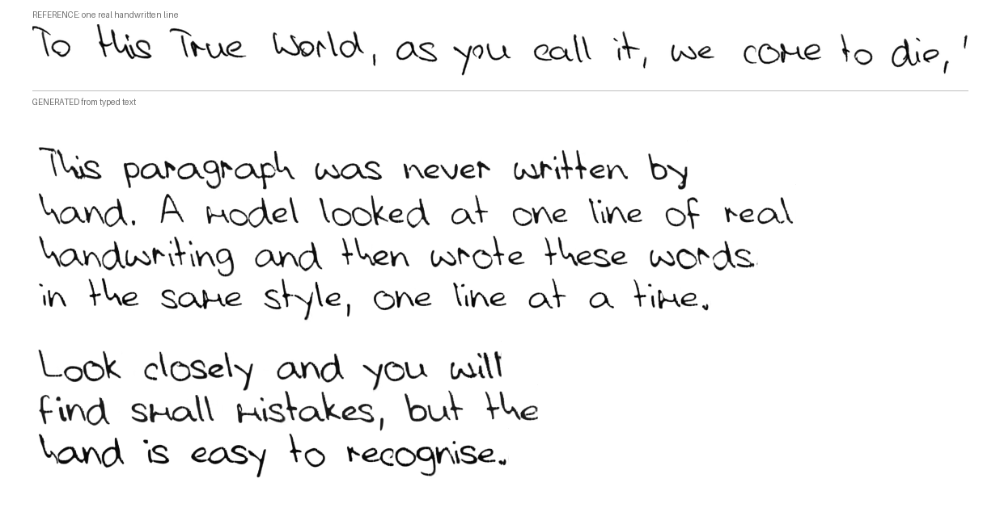
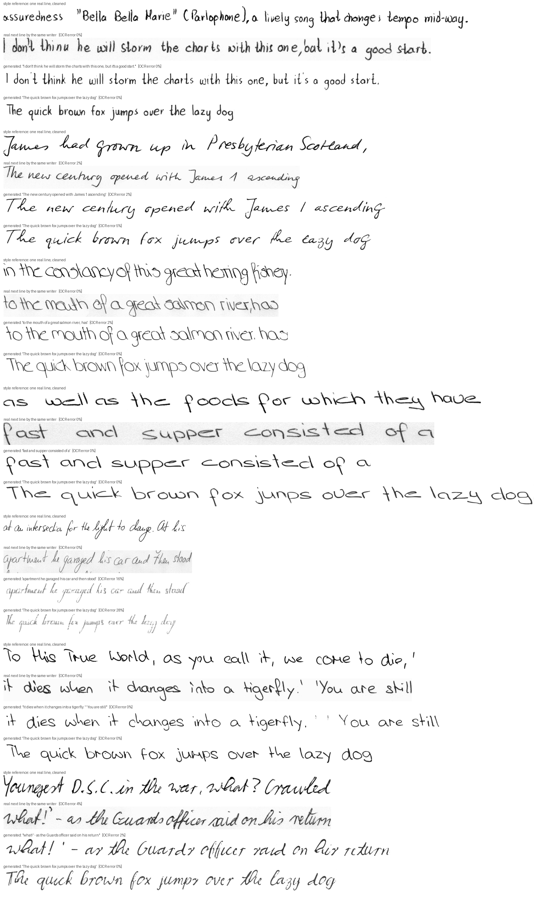
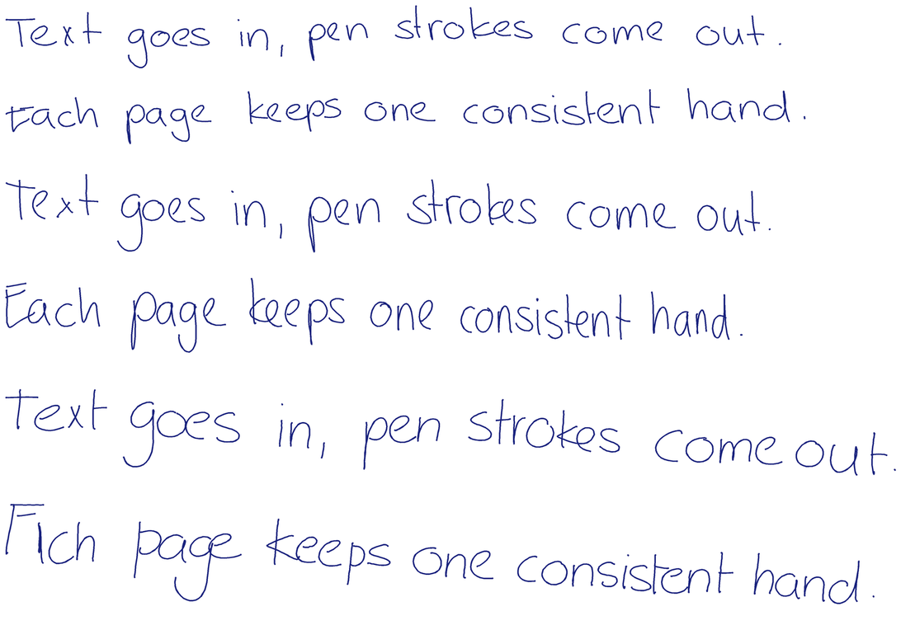

# Handwriting imitator

Goal: type text, get it back written out in a particular person's handwriting.

This folder holds the research into how that can be done and two working
prototypes, one for each of the two main ways of doing it. Both run without a
GPU (tested on 4 CPU cores) using published pretrained weights; nothing here
needed training.

## Where this stands

- **It already works from a single scanned line.** `imitate.py` takes one
  line of someone's handwriting and writes new text in that hand, about 12
  seconds per line on 4 CPU cores. Tested on 7 writers from a public research
  dataset: when a handwriting OCR model reads the output back, it gets 2.1% of
  characters wrong, against 0.9% on the same writers' real handwriting.
- **The second prototype writes with pen strokes instead of pixels.**
  `write_strokes.py` produces vector paths (SVG) that a pen plotter could draw.
  It writes in a consistent hand, but it cannot yet copy a *given* person's
  hand, because that needs a recording of their pen movements.
- **Recommended direction:** build on the image route (section 2 below). It
  needs the least from the person being imitated and is where the current
  research and ready-to-use models are. The stroke route is worth returning to
  only if the output has to be physically drawn by a machine.
- **Not yet tested on your own handwriting.** Everything below was measured on
  a public research dataset. Trying it on a phone photo of your writing is the
  first next step.

| File | What it does |
| --- | --- |
| `imitate.py` | Style photo + text → page image in that handwriting |
| `write_strokes.py` | Text → handwriting as SVG/PNG pen strokes |
| `evaluate.py` | Reproduces the measurements in this README |
| `download_models.py` | Fetches the pretrained weights (about 3 GB) |
| `hwsynth/` | Model code: `eruku.py` (image), `graves.py` (strokes), `preprocess.py`, `render.py` |

## The ways to do it

Handwriting can be represented two ways, and the choice decides everything
else. As an **image**, it is pixels, like a scan. As **strokes**, it is the
path the pen tip took, like a recording from a tablet. Images are easy to
collect (photograph a page) and strokes are not, and most recent research
works on images.

| Approach | What you need from the writer | Output | Copies a new person without training? |
| --- | --- | --- | --- |
| 1. Handwriting font | A filled-in template of every letter | Font file | Yes, by construction |
| 2. Image model with a style reference | A photo of a line or a few words | Image | Yes for the newer models |
| 3. Stroke model | A pen recording, or strokes recovered from a photo | Vector paths | Weakly |
| 4. Fine-tuning an image model | A few pages plus a GPU | Image | It is the training |

### 1. Handwriting font (no machine learning)

Services such as [Calligraphr](https://www.calligraphr.com/en/features/) turn a
scanned template into a font. Real handwriting never repeats a letter exactly,
so they let you supply several versions of each letter and cycle through them
using an OpenType feature (free accounts get 2 variants per character, paid
get 15). I have not built one. What to expect: every letter is legible and it
costs nothing to run, but the page is typeset, so the baseline is perfectly
straight, spacing is regular, and joined-up writing needs careful letter
design to connect. A sensible baseline, and the right answer if "reliable"
matters more than "convincing".

### 2. Image model with a style reference

The model is shown an example of the handwriting and the text to write, and
paints a new image. This family has moved fast:

- **GANs (2020 to 2023)**: GANwriting, Handwriting Transformers, HiGAN+, VATr.
  Mostly one word at a time, with the style taken from a set of example words.
- **Diffusion (2023 to 2025)**:
  [DiffusionPen](https://github.com/koninik/DiffusionPen) copies a style from
  five example words;
  [One-DM](https://github.com/dailenson/One-DM) from one.
  [DiffBrush](https://github.com/dailenson/DiffBrush) (ICCV 2025) generates
  whole lines rather than words, and
  [Mayr et al.](https://github.com/M4rt1nM4yr/paragraph_handwriting_imitation_ldm)
  (IJCV 2025) whole paragraphs. All four publish code; DiffusionPen and
  DiffBrush also publish weights. I did not run these, and diffusion models
  are slow without a GPU.
- **Autoregressive (2025 to 2026)**:
  [Emuru](https://huggingface.co/blowing-up-groundhogs/emuru) (CVPR 2025) was
  trained only on text rendered in over 100,000 fonts, and still copies real
  handwriting it has never seen. Its successor
  [Eruku](https://huggingface.co/blowing-up-groundhogs/eruku) (WACV 2026) adds
  real handwriting to the training data, learns when to stop, and no longer
  requires a transcript of the reference. Apache-2.0 licence, one reference
  line, arbitrary-length output.

Eruku is what `imitate.py` uses. Of the current models it asks the least: one
reference line, a permissive licence, and it turned out to run acceptably
without a GPU.

### 3. Stroke model

[Graves (2013)](https://arxiv.org/abs/1308.0850) is the classic: a recurrent
network that moves a virtual pen one small step at a time while attending to
the text. Two controls matter. *Bias* trades variety for neatness. *Priming*
feeds the network a real stroke sample first, so that it carries on in that
style. `write_strokes.py` is a re-implementation of this network, loading
weights from
[X-rayLaser's toolkit](https://github.com/X-rayLaser/pytorch-handwriting-synthesis-toolkit).

Newer stroke models exist.
[Luhman & Luhman (2020)](https://github.com/tcl9876/Diffusion-Handwriting-Generation)
use diffusion and take the style from an image of the writing rather than a
pen recording. [DiffInk](https://arxiv.org/abs/2509.23624) (ICLR 2026)
generates full lines with a diffusion transformer.

The obstacle is input. To copy someone this way you need their strokes: either
have them write on a tablet, or recover strokes from a photo with
[InkSight](https://github.com/google-research/inksight), a Google model that
does exactly that conversion and has public weights.

### 4. Fine-tuning

Training one of the image models further on a few pages of one person's
writing is the standard next step when a reference alone does not get close
enough. It needs a GPU and transcribed samples, and is untested here. Emuru's
[training code](https://github.com/aimagelab/Emuru-autoregressive-text-img) is
public.

## Prototype 1: `imitate.py` (image route)

```bash
python download_models.py
```

```bash
python imitate.py --style my_line.jpg --style-text "what that line says" --out page.png "Text to write out by hand."
```

The reference image should be one full line (a short phrase is not enough),
dark ink on plain paper. Long text is wrapped and each line is generated
separately from the same reference, then stacked into a page.



*Top: the single real line used as reference. Below: a paragraph generated
from it.*

### How well it works

For each of 7 writers from the IAM test set, one real line is the reference
and the model writes the words of that writer's next line, so the output can
be put beside the real thing:



*Per writer: the reference line, the writer's real next line, the model's
version of that line, and a pangram. Generated here without guidance.*

Legibility is measured by having a handwriting OCR model (TrOCR) read each
output and counting the characters it gets wrong (character error rate, lower
is better). 14 lines per row: 2 per writer.

| Setup | OCR character errors | Lines that ran away |
| --- | --- | --- |
| Real handwriting, same writers (baseline) | 0.9% | n/a |
| Cleaned reference + transcript + guidance 1.25 (`imitate.py` default) | 2.1% | 0 of 14 |
| Cleaned reference + transcript, no guidance | 4.0% | 0 of 14 |
| Cleaned reference, no transcript, no guidance | 15.0% | 1 of 14 |
| Raw scan + transcript, no guidance | 12.8% | 1 of 14 |

How to read this. Most lines are clean: without guidance, 8 of 14 read back
with no errors and 12 of 14 with at most 5%. The averages are driven by two
things. One writer with small, faint joined-up writing (fifth in the figure)
scores 16% and 28%, and guidance is what helps there, bringing those to 5% and
14% while leaving the other six writers unchanged. And each runaway line (see
below) counts as about 90% error, which is the whole gap in the bottom two
rows. With only 14 lines, differences between rows are indications, not
precise measurements.

Caveat: this is the friendly case. Eruku's training data included part of
this same dataset, and I could not confirm these 7 writers were excluded from
it. The OCR model was trained on it too. Expect worse on a phone photo until
that is tested.

### What I learned getting here

- **The model copies how the reference was digitised, not only the
  handwriting.** My first clean-up step thresholded the image and left wide
  margins; the output came back blocky and small. The current step only evens
  out the paper and crops tight, keeping the soft stroke edges.
- **It sometimes runs away.** Instead of ending a line it draws a rule across
  the page. `imitate.py` detects this (the model never signals "end") and
  redraws with a new random seed, which usually fixes it. In the test above
  the only runaways were without a transcript or without clean-up.
- **Very short lines come out heavy and smeared.** Anything under about 15
  characters. `imitate.py` evens out line lengths to avoid leaving a word or
  two alone on a line, but a one-word title or sign-off will show it.
- **The reference has to be a full line.** Given only a word or two, one test
  writer came out in a noticeably more generic hand and another ran away on
  all five tries. The same writers' full lines worked.
- **"Guidance" in the official demo does nothing.** The published inference
  code runs the model twice per step for classifier-free guidance, but with
  its default settings both runs get identical inputs, so the scale has no
  effect. `hwsynth/eruku.py` implements it so that it does act on the text
  prompt. At 1.25 it darkens faint writing and fixes some misspellings; by 2.0
  it visibly distorts the letters.
- **Speed.** The reference code recomputes the whole sequence at every step.
  With caching added, a line takes about 7 s on 4 CPU cores, or 12 s with
  guidance on.
- **Resolution is the main limit.** Lines are 64 pixels tall. That is fine on
  screen and soft in print.

## Prototype 2: `write_strokes.py` (stroke route)

```bash
git clone https://github.com/X-rayLaser/pytorch-handwriting-synthesis-toolkit
```

```bash
python write_strokes.py --checkpoint pytorch-handwriting-synthesis-toolkit/checkpoints/Epoch_52 --out page "First line." "Second line."
```

Writes `page.svg`, `page.png` and the raw strokes. `--style-seed` picks the
hand; every line on a page is primed with the same sample so the page stays
consistent. Only the repository's weight files are used; the model code is in
`hwsynth/graves.py`.



*Three style seeds, two lines each.*

- Fast and tiny: about 2 seconds per line on one CPU core.
- Output is resolution-independent and has a stroke order, so it can be
  plotted or animated.
- Lower-case text is reliable. Capitals are not: the "E" above is wrong in two
  of three hands.
- It derails fairly often: 7 of 60 lines on the first draw in my test, and 4
  of 20 style samples. A derailed style sample ruins every line primed on it.
  The code detects both and redraws; 2 of 60 lines were still bad after 4
  tries, and those are reported with a warning.
- The hands it produces are the model's own. Priming on a real person's
  strokes is supported by the code (`Handwriter.write(prime=...)`) but
  untested, since no real stroke recording was available.

## Next steps, in order

1. **Try it on real target handwriting.** Photograph 3 to 5 lines on unlined
   paper, type what each says, run `imitate.py`. This decides whether the
   reference-only route is good enough or fine-tuning is needed.
2. **Check every line automatically.** `evaluate.py` already reads output back
   with OCR. Doing that inside `imitate.py`, and redrawing any line that does
   not match its text, would remove most misspellings.
3. **Use several reference lines.** Rotating between a few references per
   page should add natural variation and cover more letter shapes.
4. **Make it look like paper.** Ruled-paper background, ink colour, slight
   line drift, and upscaling or vectorising for print.
5. **If strokes are needed:** recover strokes from the photo with InkSight and
   prime the stroke model with them.

Use this on your own handwriting, or with the writer's agreement. Signatures
and anything meant to pass as written by someone else are out of scope.

## Setup

```bash
pip install -r requirements.txt
```

Tested on Python 3.13 with torch 2.15 and transformers 5.23. The image model
needs about 5 GB of RAM and 3 GB of disk; the evaluation downloads another
1.3 GB for the OCR model.

## Sources

- Graves, *Generating Sequences With Recurrent Neural Networks*, 2013. <https://arxiv.org/abs/1308.0850>
- Pippi et al., *Zero-Shot Styled Text Image Generation, but Make It Autoregressive* (Emuru), CVPR 2025. <https://arxiv.org/abs/2503.17074>
- Zaccagnino et al., *Autoregressive Styled Text Image Generation, but Make it Reliable* (Eruku), WACV 2026. <https://arxiv.org/abs/2510.23240>
- Dai et al., *One-Shot Diffusion Mimicker for Handwritten Text Generation* (One-DM), ECCV 2024. <https://arxiv.org/abs/2409.04004>
- Nikolaidou et al., *DiffusionPen*, ECCV 2024. <https://github.com/koninik/DiffusionPen>
- Dai et al., *Beyond Isolated Words: Diffusion Brush for Handwritten Text-Line Generation* (DiffBrush), ICCV 2025. <https://arxiv.org/abs/2508.03256>
- Mayr et al., *Zero-Shot Paragraph-level Handwriting Imitation with Latent Diffusion Models*, IJCV 2025. <https://link.springer.com/article/10.1007/s11263-025-02525-0>
- Luhman & Luhman, *Diffusion models for Handwriting Generation*, 2020. <https://arxiv.org/abs/2011.06704>
- Pan et al., *DiffInk*, ICLR 2026. <https://arxiv.org/abs/2509.23624>
- Google Research, *InkSight: Offline-to-Online Handwriting Conversion by Learning to Read and Write*, 2024. <https://arxiv.org/abs/2402.05804>
- Curated list of methods, datasets and metrics: <https://github.com/koninik/awesome-handwritten-text-generation>
- Evaluation lines: IAM Handwriting Database (Marti & Bunke, 2002), via `Teklia/IAM-line` on Hugging Face. Free for non-commercial research.
