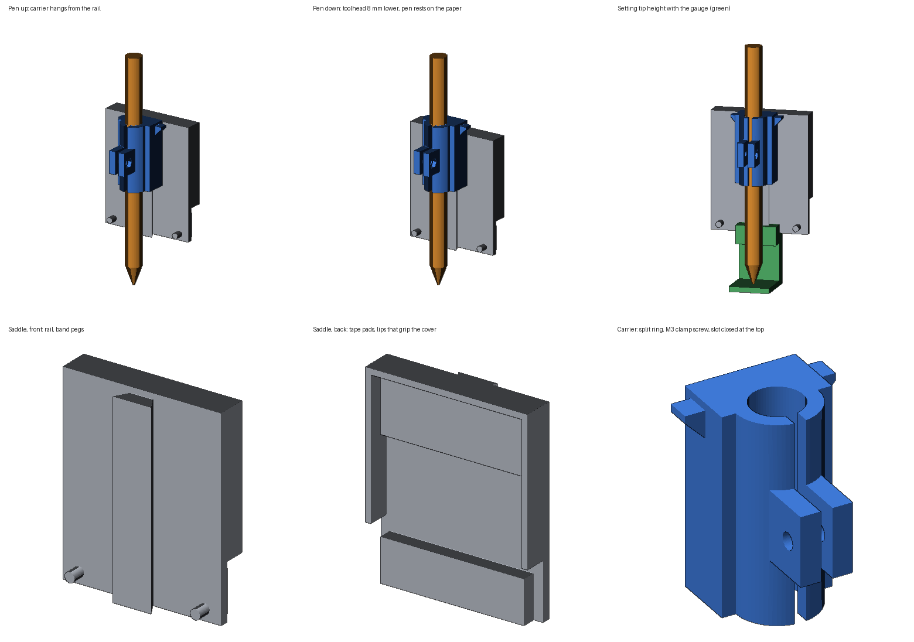

# Pen and pencil holder for the Bambu Lab A1 mini

A holder that rides on the printer's own clip-on front cover and lets the pen
rest on the paper under its own weight.



**Status: designed, not yet printed or fitted.** The cover width and rim depth
are measured from the owner's printer. Four dimensions are still estimates,
listed below. Print the saddle alone first and check it against the cover
before printing the rest.

## Parts

Ready-to-print files are in `build/` (STL for the slicer, STEP for editing).

| Part | What it does |
| --- | --- |
| `saddle` | Sits on the front cover. Lips on the top and sides locate it, two pads take foam tape, the middle clears the lens dome. A rail runs down the front. |
| `carrier` | Slides on the rail and grips the pen in a split ring closed by one screw. |
| `gauge` | Sets how far the pen tip hangs down, so every pen loads to the same height. |
| `fit_test` | A short slice of rail and slot, to tune the sliding fit before the long print. |

You also need one M3 x 16 screw with a nut, double-sided foam tape, and
optionally a small rubber band.

## Why the pen floats

The printer does not press the pen down. The carrier hangs from the top of the
rail. When the toolhead lowers, the tip touches the paper first, the carrier
stops, and the rail keeps going for a few millimetres. The pen then sits on the
paper under its own weight.

- The drawing height only has to land inside the 12 mm of float, not be exact.
- A pencil keeps touching as its lead wears down.
- A wrong height cannot drive anything rigid into the bed.
- The cover unclips, so the whole pen assembly comes off in one piece. Take it
  off before homing, because homing lowers the nozzle onto the bed.

For more pressure (pencils usually want it), stretch a rubber band from the
carrier's side lugs down to the two pegs on the saddle.

## Printing

- PETG rather than PLA. The holder sits in front of the hotend, and PLA softens
  at temperatures that area can reach.
- Saddle: on its back, rail facing up. No supports.
- Carrier: standing upright, bore vertical. No supports.
- Print `fit_test` first. If the slot is tight or rattles, regenerate with a
  different `--clearance` (default 0.25 mm per side).

## Fitting

1. Unclip the front cover. Press the saddle onto its front, top edges level,
   and check the side lips straddle the cover and the lens dome is not touching.
2. If it fits, stick it down with foam tape on the two pads.
3. Slide the carrier onto the rail from the top. It should drop freely and stop
   on the top of the rail.
4. Put the pen through the ring. Hook the gauge under the saddle with its fence
   around the rail, let the pen drop until the tip touches the shelf, and
   tighten the screw.
5. Clip the cover back on the printer after homing.

## Pencils

A floating holder keeps a wearing lead on the paper, but an ordinary mechanical
pencil stops marking once the lead is flush with its metal sleeve. Two ways
round that:

- A pencil that feeds lead by itself each time the tip leaves the paper, such
  as the Pentel Orenz Nero or Uni Kuru Toga Dive. A plotter lifts the tip
  hundreds of times a page, so this needs no extra mechanism. Not yet tried.
- A 2 mm lead holder with several millimetres of lead exposed. Simple, but the
  line widens as the tip blunts.

## Still to confirm on the printer

Set these on the command line once measured; the defaults are estimates.

| What | Default | Option |
| --- | --- | --- |
| How far the lens dome stands proud of the cover | 5.0 mm allowed | `--lens-clearance` |
| Pen or pencil barrel diameter | 10.0 mm | `--pen-diameter` |
| Tip distance below the saddle's bottom edge (about 3 mm below the nozzle) | 28.0 mm | `--tip-drop` |
| Cover height | about 73 mm | saddle is 68 mm tall, top-aligned |

Also unchecked: whether the grey fan ducts at the bottom of the toolhead reach
far enough forward to touch the pen. The pen's centre line is 21 mm in front of
the cover face.

## Regenerating

```bash
pip install cadquery
```

```bash
python pen_mount.py --out build --pen-diameter 9.5 --lens-clearance 4
```

```bash
python render.py mount.png
```

`pen_mount.py` also runs collision and fit checks on the model and fails if any
do not hold.
